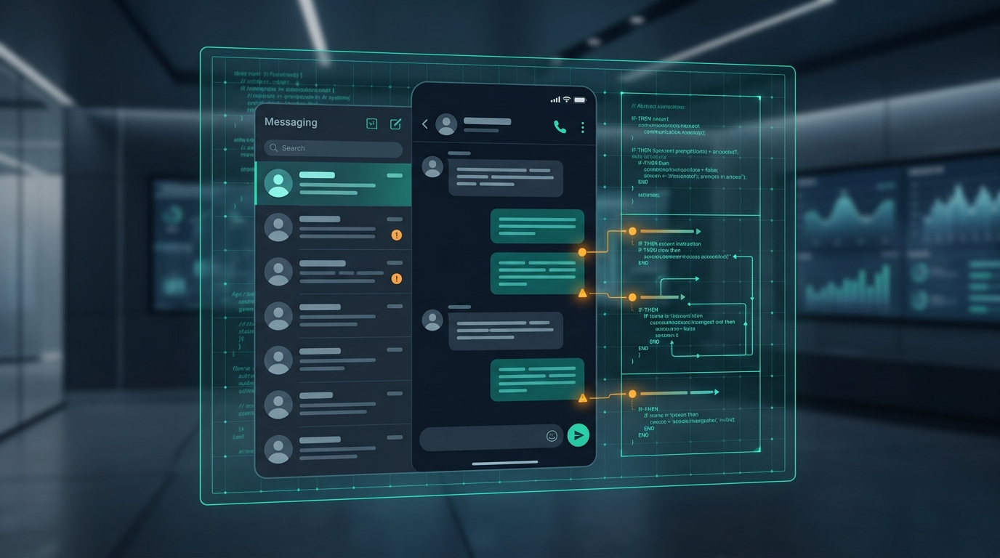

# WhatsApp Hidden AI Instructions: Privacy and Threat Analysis

Security researchers and reverse engineers have uncovered hidden system prompt instructions and background telemetry directives embedded within WhatsApp's integrated Meta AI assistant. These undocumented system configurations dictate data retention, model behavior guardrails, and context sharing across end-to-end encrypted messaging channels, raising critical privacy concerns for enterprise users.\n\nOur latest security analysis dissects the uncovered system prompts, privacy implications for encrypted messaging platforms, and corporate risk mitigation guidelines.\n\nRead the full technical security breakdown on our official security portal.

**[Read the full technical breakdown here](https://cyberupdates365.com/whatsapp-hidden-ai-instructions/)**

---
*Maintained by Kiran Sonawane | Senior Cloud & DevOps Engineer*
